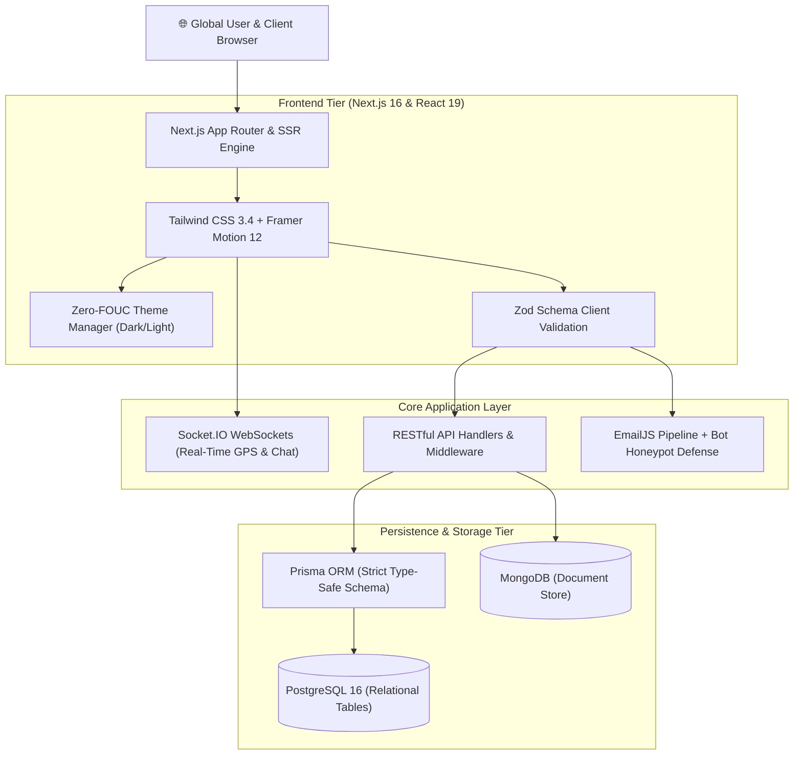

<div align="center">

# ⚡ Md Samim Hosen
### **Software Engineer & Full Stack Developer**

<!-- Dynamic Animated Typing Banner -->
[](https://samimhosen.vercel.app)

<br />

**Full Stack Developer at [JEVXO](https://jevxo.com)** &nbsp;•&nbsp; **Diploma in Computer Technology at Rangpur Polytechnic Institute** &nbsp;•&nbsp; **Top Seller on [Fiverr](https://www.fiverr.com/samim_io)**

<br />

[](https://samimhosen.vercel.app/)
[](https://drive.google.com/file/d/1liEkw82D8zQL0-A0BIqw-PK5l7UBEo7C/view?usp=sharing)
[](https://wa.me/8801743282144)
[](https://www.fiverr.com/samim_io)

</div>

<br />

<div align="center">

| 💼 Primary Role | 🎓 Academic Roots | 📍 Engineering Base | ⚡ Working Status |
| :---: | :---: | :---: | :---: |
| Full Stack Developer @ **JEVXO** | Diploma in Computer Tech (Completed) @ **Rangpur Polytechnic** | Rangpur, Bangladesh (UTC+6) | **Available for Q4 Client Projects** |

</div>

---

## 🏛️ System Architecture

This portfolio and my client applications are engineered following modern **Clean Architecture** principles, prioritizing strict type-safety, sub-second latency, and fluid interaction:



---

## 🛠️ Categorized Technical Stack

<div align="center">

### 💻 Frontend & Interface Engineering
[](https://nextjs.org/)
[](https://react.dev/)
[](https://www.typescriptlang.org/)
[](https://tailwindcss.com/)
[](https://www.framer.com/motion/)
[](https://redux-toolkit.js.org/)

### ⚙️ Backend, Real-Time & Cloud APIs
[](https://nodejs.org/)
[](https://expressjs.com/)
[](https://socket.io/)
[](https://jwt.io/)
[](https://stripe.com/)
[](https://firebase.google.com/)

### 🗄️ Databases, DevOps & Toolchain
[](https://www.postgresql.org/)
[](https://www.prisma.io/)
[](https://www.mongodb.com/)
[](https://www.docker.com/)
[](https://git-scm.com/)
[](https://vercel.com/)
[](https://www.postman.com/)

</div>

---

## 🎯 Engineering Quality & Reliability Standards

I adhere to strict engineering benchmarks across every production platform:

<div align="center">

| Metric / Dimension | Target Standard | Engineering Implementation |
| :--- | :---: | :--- |
| **Performance** | **95+ Lighthouse** | Sub-second First Contentful Paint (FCP), Turbopack compilation, image optimization via `next/image` |
| **Type-Safety** | **Strict TypeScript** | 100% type coverage, Zod schema runtime validation, zero loose `any` fallbacks |
| **Theme System** | **Zero FOUC** | Pre-paint blocking `<head>` script preventing flashes of wrong theme on hard reloads |
| **Security & Spam** | **Enterprise Grade** | Cryptographic token validation, input sanitization, and hidden honeypot bot defense |
| **Client Privacy** | **NDA Compliant** | Strict Non-Disclosure Agreement adherence, 100% intellectual property & source code ownership |

</div>

---

## 💼 Featured Production Projects

<div align="center">

| Project | Primary Stack | Core Highlights | Links |
| :--- | :--- | :--- | :---: |
| **🛰️ LocalLink** | Next.js 16 · Socket.IO · PostgreSQL · Prisma · MapLibre GL | Real-time GPS location sharing, custom spatial geofencing & instant SOS broadcast | [Demo](https://github.com/samimcodes) · [Code](https://github.com/samimcodes) |
| **🚀 CareerFlow** | React 19 · Redux · Node.js · MongoDB · Stripe · Gemini AI | Drag-and-drop Kanban pipeline, AI cover letter generator & recurring Stripe subscriptions | [Demo](https://career-flow-six.vercel.app/) · [Code](https://github.com/samimcodes/careerflow-job-tracker) |
| **🏆 ContestHub** | React · Tailwind · Express · MongoDB · Firebase · Stripe | Role-based dashboards (Admin, Creator, User), contest approvals & dynamic leaderboards | [Demo](https://contests-hub.netlify.app/) · [Code](https://github.com/samimcodes/ContestHub_Client) |
| **🏠 HomeHero** | React · Node.js · Express · MongoDB · Firebase Auth | On-demand household booking platform, slot availability validation & review aggregation | [Demo](https://homehero-ass10.netlify.app/) · [Code](https://github.com/samimcodes/homehero-a10-client) |

</div>

---

## ⚙️ Local Development Setup

### 1. Clone & install
```bash
git clone https://github.com/samimcodes/Portfolio.git
cd Portfolio
npm install
```

### 2. Environment configuration
Create a `.env.local` file in the project root:
```env
NEXT_PUBLIC_EMAILJS_SERVICE_ID=your_service_id
NEXT_PUBLIC_EMAILJS_TEMPLATE_ID=your_template_id
NEXT_PUBLIC_EMAILJS_PUBLIC_KEY=your_public_key
```

### 3. Run development server
```bash
npm run dev
```
Open [http://localhost:3000](http://localhost:3000) to view the live interface.

### 4. Production build & validation
```bash
npm run build
npm run start
```

---

## 📬 Direct Contact & Inquiries

Whether you have an upcoming web application, need an experienced full-stack engineer for your sprint, or want to discuss technical architecture — feel free to reach out directly:

<div align="center">

[](https://wa.me/8801743282144)
[](https://www.fiverr.com/samim_io)
[](mailto:mdsamimhoen827@gmail.com)
[](https://www.linkedin.com/in/samim01/)
[](https://github.com/samimcodes)

<br />

📍 **Rangpur, Bangladesh (UTC+6) &nbsp;•&nbsp; Open to Worldwide Remote Opportunities**

<br />

⭐ **If you find this portfolio or its architecture helpful, please consider starring the repository!**

*Engineered with precision by [Md Samim Hosen](https://github.com/samimcodes).*

</div>
